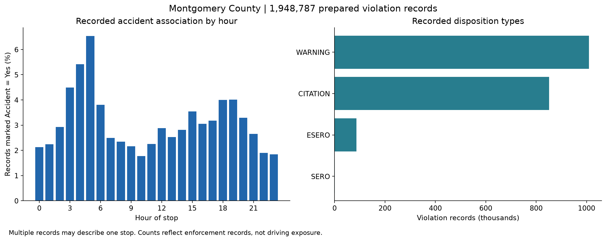
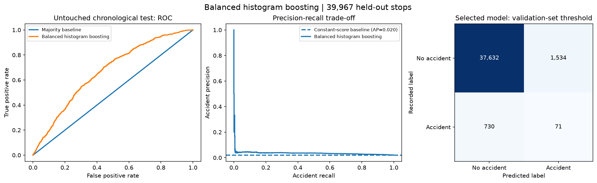

# Traffic Accident Risk Analysis

A reproducible Python project for exploring recorded traffic violations and evaluating accident-label classification under class imbalance. Developed from DATA 602 coursework and revised into a source-backed portfolio analysis.



## What this project does

- Audits and prepares the original CSV in chunks instead of relying on an Excel-limited subset.
- Explores recorded accident association by stop timing and administrative disposition.
- Compares a majority-class baseline, a single-tree reference, balanced logistic regression, a balanced random forest, and histogram gradient boosting.
- Uses one record per eligible stop and chronological training, validation, and test partitions.
- Reports accident-class precision, recall, F1, ROC-AUC, average precision, and confusion counts rather than promoting accuracy alone.

## Source and scope

Data comes from the [Data.gov Traffic Violations catalog](https://catalog.data.gov/dataset/traffic-violations) and [Montgomery County publisher](https://data.montgomerycountymd.gov/d/4mse-ku6q). The records cover issued electronic violations in Montgomery County, Maryland. They do not represent all Maryland drivers or all crashes.

The evaluated local CSV contains **1,951,063 records**, covering **January 1, 2012 through September 16, 2024**. Exact-row deduplication removes **2,276 records**, leaving **1,948,787 violation records** and **1,105,586 distinct stop IDs**. Multiple violations can describe one stop. The prepared record-level `Accident = Yes` share is **2.74%**; that is not an exposure-adjusted crash probability.

Large source files and generated row-level data stay local and are ignored by Git. Download instructions are in [data/README.md](data/README.md). No Git LFS or redistribution of the original CSV/Excel files is needed.

## Notebook sequence

| Notebook | Purpose |
| --- | --- |
| [01 - Problem and data](notebooks/01_problem_and_data.ipynb) | Source, record grain, population, and study question |
| [02 - Preparation and quality](notebooks/02_preparation_and_quality.ipynb) | Chunked cleaning, exclusion counts, and input validation |
| [03 - Exploratory analysis](notebooks/03_exploratory_analysis.ipynb) | Rates, group denominators, and focused figures |
| [04 - Model benchmark](notebooks/04_model_benchmark.ipynb) | Reproducible baseline and candidate-model comparison |
| [05 - Results and limitations](notebooks/05_results_and_limitations.ipynb) | Computed conclusions and limitations |

The original notebooks remain local in `Answer/`, with a backup in `_original_coursework/`. Both directories are ignored by Git. Their Colab widgets and coursework claims are not part of the portfolio notebook sequence.

## Reproduce

Python 3.12 was used for the verified run. Create an isolated environment from the repository root:

```bash
python3 -m venv .venv
source .venv/bin/activate
python -m pip install -r requirements.txt
```

`requirements-lock.txt` records the exact environment used for the saved results. For an exact package-version installation on compatible Python, use `python -m pip install -r requirements-lock.txt` instead.

Download the original CSV as described in [data/README.md](data/README.md), then run:

```bash
python scripts/run_analysis.py
```

This prepares the full local CSV, creates aggregate audit files and figures, and benchmarks up to 200,000 randomly sampled eligible stop IDs using seed 42. The sampling is over stops, not independently sampled violation rows. To rerun models on already prepared data:

```bash
python scripts/run_analysis.py --skip-prepare --max-stops 200000
```

To execute and save all five notebooks and local HTML previews:

```bash
python scripts/execute_notebooks.py
```

Run the regression checks for record deduplication, unknown-value handling, chronological stop isolation, and the majority-baseline accuracy trap:

```bash
python -m unittest discover -s tests -v
```

Notebooks load local paths and need no Colab upload/download widgets. Do not publish local data or preview directories. Saved notebooks include aggregate results and focused figures for reading on GitHub.

## Evaluation design

The target is the recorded `Accident` field. This is a **retrospective classification benchmark**, not a validated forecast of future crashes.

Stops with conflicting target labels are excluded and counted. The first source record supplies the retained stop features. The sample is split chronologically into approximately 60% training, 20% validation, and 20% test; an entire date stays in one partition. Preprocessing is fitted on training data only. The model is selected using validation average precision, and its threshold is selected by validation accident-class F1. The test set is evaluated after selection.

Features are hour, weekday, month, vehicle age, subagency, vehicle type, alcohol indicator, work-zone indicator, and commercial-vehicle indicator. Demographic variables, exact locations, injury/fatality/damage fields, accident-contribution flags, charge descriptions, violation dispositions, and record IDs are excluded. Some included fields may be recorded during investigation, so performance must not be represented as pre-incident prediction.

## Verified model results

The verified benchmark samples **200,000 eligible stop IDs**. Training ends September 12, 2017; validation covers September 13, 2017 through August 2, 2019; and the untouched test set covers August 3, 2019 through September 16, 2024. It contains **39,967 stops**, including **801 accident-positive stops (2.00%)**. The full eligible population contains **4,744 stop IDs with inconsistent target labels**, which are excluded before sampling.

**Histogram gradient boosting was selected by validation average precision.** It shows limited ranking signal, but low accident precision. It is not a reliable operational accident detector.

| Test-set model / threshold | Accuracy | Accident precision | Accident recall | Accident F1 | ROC-AUC | Average precision |
| --- | ---: | ---: | ---: | ---: | ---: | ---: |
| Always no accident | 98.00% | 0.00% | 0.00% | 0.000 | 0.500 | 0.020 |
| Single-tree reference, 0.5 | 98.00% | 0.00% | 0.00% | 0.000 | 0.613 | 0.030 |
| Balanced logistic regression, 0.5 | 62.05% | 3.04% | 58.05% | 0.058 | 0.646 | 0.035 |
| Balanced random forest, 0.5 | 71.20% | 3.36% | 48.19% | 0.063 | 0.665 | 0.035 |
| Selected histogram boosting, 0.5 | 61.88% | 3.23% | 62.17% | 0.061 | 0.667 | 0.036 |
| Selected histogram boosting, validation threshold 0.6483 | 94.34% | 4.42% | 8.86% | 0.059 | 0.667 | 0.036 |

At the validation-selected threshold, the model detects **71 of 801** positive stops, misses **730**, and produces **1,534 false positives**. Its validation-optimized threshold does not transfer well to the later test period. Lowering the threshold to 0.5 improves recall but produces 14,931 false positives. Ranking performance above chance does not establish practical usefulness.



Exact results are in [test metrics](reports/test_metrics.csv), [validation metrics](reports/validation_metrics.csv), and [run metadata](reports/model_run.json). These are new real-data results, not a reinterpretation of the old synthetic ROC curves. Model and threshold selection were completed before inspecting the test metrics.

## Corrections to the coursework

The original notebook 5 simulated random features and labels before computing ROC-AUC values near 0.45 and 0.47. Those values are **not results on traffic data**. The original notebook 4's approximately 96.8% accuracy was not sufficient evidence of useful accident classification; it lacked a majority baseline and accident-class evaluation.

The revised benchmark uses real data, explicit baselines, reproducible splits, and honest class-specific metrics. Its population and features differ from the coursework, so historical and revised numbers are not a controlled before/after comparison. The original claim that the hypothesis was validated has been removed from the portfolio narrative.

## Limitations

- Records reflect enforcement and reporting, not driving exposure. Associations cannot establish causes of crashes or justify demographic targeting.
- `Violation Type` describes dispositions such as Citation and Warning, not speeding-versus-DUI categories.
- `Accident` and `Contributed To Accident` are distinct source fields.
- The full raw CSV differs from the Excel-limited coursework subset and historical cleaned CSV.
- The model benchmark uses a bounded stop sample, not every available stop, and has no independent external validation.
- Missingness mechanisms are not assumed to be MCAR or MAR. Unknown predictors are retained, and invalid vehicle years become missing.
- The final observed year is incomplete. Changes across time can reflect reporting or enforcement changes.
- The F1-selected threshold is illustrative. Operational use would require predictor-timing validation, calibration, costs, and a fresh external holdout.

## Project structure

```text
traffic-accident-risk-analysis/
|-- README.md
|-- .gitignore
|-- requirements.txt
|-- requirements-lock.txt
|-- data/README.md
|-- notebooks/                    # five executed analysis notebooks
|-- src/traffic_analysis.py       # preparation, metrics, models, and figures
|-- scripts/                      # command-line and notebook execution
|-- tests/                        # data and evaluation regression checks
|-- reports/                      # small aggregate audit and metric outputs
`-- assets/                       # analytical figures
```

This repository is prepared for Git-based upload. `.gitignore` excludes the large datasets, environments, original coursework, and local previews. Browser drag-and-drop uploads do not apply Git ignore rules; use Git when publishing the project.
